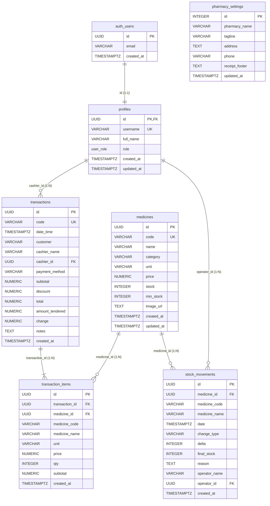
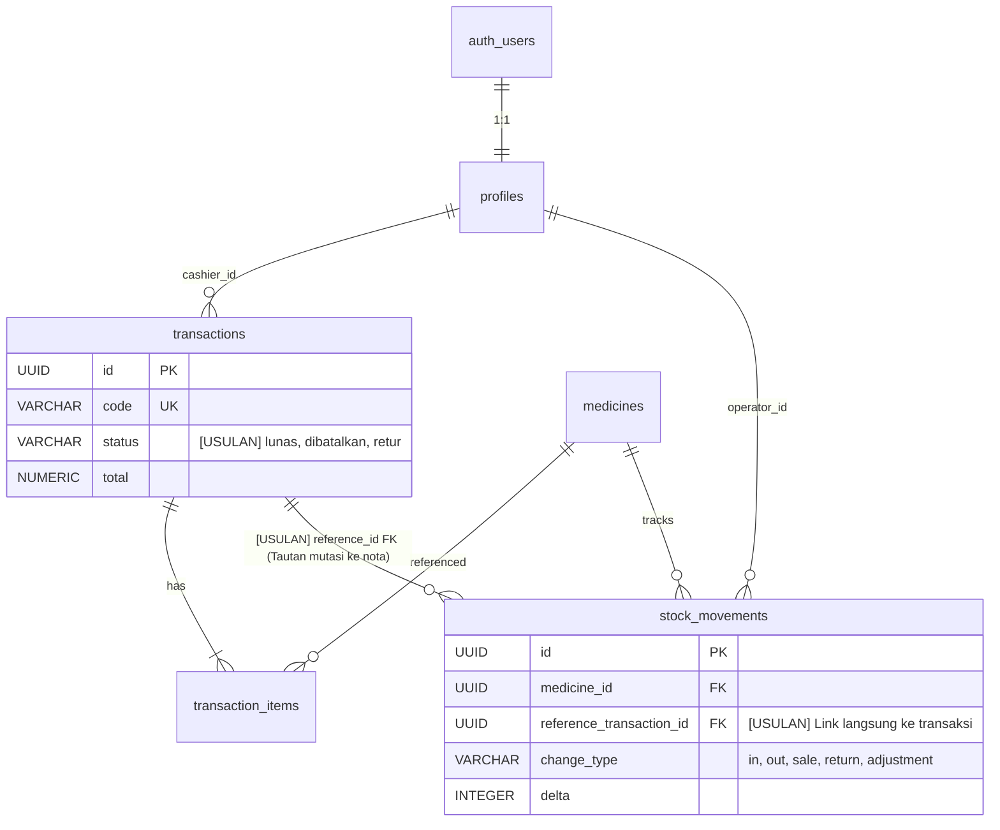

# DOKUMENTASI LENGKAP ENTITY RELATIONSHIP DIAGRAM (ERD) & ARSITEKTUR DATABASE
## Proyek: Apotek Sri Redjeki Farma
**Platform:** PostgreSQL (Supabase) | **Arsitektur:** Point of Sale (POS) & Manajemen Stok Apotek

---

## 1. RINGKASAN HASIL AUDIT

Berdasarkan audit teknis terhadap database PostgreSQL pada Supabase dan kode sumber aplikasi Apotek Sri Redjeki Farma:
1. **Schema Resmi:** Seluruh tabel aplikasi berada pada schema `public`, terhubung secara terintegrasi dengan tabel autentikasi internal Supabase pada schema `auth.users`.
2. **Total Tabel:** Terdapat **6 tabel utama** pada schema `public` (`profiles`, `medicines`, `transactions`, `transaction_items`, `stock_movements`, `pharmacy_settings`) dan **1 tabel autentikasi** pada schema `auth` (`users`).
3. **Integritas Referensial (Foreign Keys):** Seluruh relasi fisik antara master, header transaksi, rincian item, dan mutasi stok telah ditegakkan menggunakan constraint foreign key resmi PostgreSQL (`ON DELETE CASCADE` atau `ON DELETE SET NULL`).
4. **Pola Desain POS Snapshot:** Tabel `transaction_items` dan `stock_movements` menerapkan pola *Snapshot Archiving* (menyimpan salinan `medicine_code`, `medicine_name`, `price`, dan `unit` pada saat transaksi terjadi). Hal ini menjamin bahwa perubahan harga atau nama obat di masa depan tidak akan merusak keabsahan riwayat struk dan pembukuan keuangan masa lalu.
5. **Keamanan & Peran (RBAC):** Tabel `profiles` mengimplementasikan tipe ENUM kustom `user_role ('Kasir', 'Apoteker / Owner')` dengan proteksi Row Level Security (RLS) serta trigger otomatis saat registrasi pengguna baru.

---

## 2. DAFTAR TABEL & OBJEK DATABASE YANG DIPERIKSA

| No | Nama Schema | Nama Objek | Tipe Objek | Deskripsi Fungsional |
|---|---|---|---|---|
| 1 | `auth` | `users` | Table | Tabel internal Supabase Auth penyimpan akun dan kredensial terenkripsi. |
| 2 | `public` | `profiles` | Table | Ekstensi identitas pengguna (username, nama lengkap, role apotek). |
| 3 | `public` | `medicines` | Table | Master data katalog obat, kategori, satuan, harga jual, dan stok fisik. |
| 4 | `public` | `transactions` | Table | Header transaksi penjualan kasir (kode invoice, pelanggan, total bayar). |
| 5 | `public` | `transaction_items` | Table | Detail item obat yang terjual dalam setiap transaksi kasir. |
| 6 | `public` | `stock_movements` | Table | Buku besar audit pergerakan stok (restok, barang rusak/expired, opname). |
| 7 | `public` | `pharmacy_settings` | Table | Tabel singleton (1 baris) penyimpan nama, alamat, telepon, dan footer struk. |
| 8 | `public` | `user_role` | Enum Type | Tipe enumerasi peran: `'Kasir'` dan `'Apoteker / Owner'`. |
| 9 | `public` | `process_checkout` | Function (RPC) | Fungsi transaksi atomik POS (pengurangan stok, pembuatan invoice, dan item). |
| 10| `public` | `adjust_stock` | Function (RPC) | Fungsi atomik penyesuaian stok manual dengan penguncian baris (`FOR UPDATE`).|

---

## 3. VERSI A — ERD AKTUAL (PHYSICAL ERD)

Diagram berikut merefleksikan struktur fisik database saat ini sebagaimana didefinisikan pada database Supabase:



---

## 4. VERSI B — ERD RELASIONAL TERPERINCI (DETAILED DEVELOPER ERD)

Diagram ini memperlihatkan detail batasan integritas, kardinalitas, jenis relasi (fisik vs logis), serta indeks pendukung query transaksi:

```mermaid
erDiagram
    %% RELASI FISIK DENGAN CONSTRAINT DATABASE
    auth_users ||--|| profiles : "[FISIK] 1:1 ON DELETE CASCADE"
    profiles ||--o{ transactions : "[FISIK] 1:N ON DELETE SET NULL"
    profiles ||--o{ stock_movements : "[FISIK] 1:N ON DELETE SET NULL"
    transactions ||--|{ transaction_items : "[FISIK] 1:N ON DELETE CASCADE"
    medicines ||--o{ transaction_items : "[FISIK] 1:N ON DELETE SET NULL"
    medicines ||--o{ stock_movements : "[FISIK] 1:N ON DELETE CASCADE"

    %% RELASI LOGIS APLIKASI
    transactions ..o{ stock_movements : "[LOGIS] Pelacakan invoice penjualan"
    pharmacy_settings ..o{ transactions : "[LOGIS] Header profil apotek pada cetak struk"

    profiles {
        UUID id PK,FK "auth.users.id CASCADE"
        VARCHAR_50 username UK "Index: idx_profiles_username"
        VARCHAR_100 full_name "Nama staf"
        user_role role "Index: idx_profiles_role"
        TIMESTAMPTZ created_at "Default now()"
        TIMESTAMPTZ updated_at "Auto trigger updated_at"
    }

    medicines {
        UUID id PK "uuid_generate_v4()"
        VARCHAR_30 code UK "Index: idx_medicines_code"
        VARCHAR_150 name "Nama sediaan"
        VARCHAR_80 category "Index: idx_medicines_category"
        VARCHAR_30 unit "Default 'Strip'"
        NUMERIC_15_2 price "CHECK price >= 0"
        INTEGER stock "CHECK stock >= 0"
        INTEGER min_stock "CHECK min_stock >= 0"
        TEXT image_url "Nullable URL"
        TIMESTAMPTZ created_at "Default now()"
        TIMESTAMPTZ updated_at "Auto trigger updated_at"
    }

    transactions {
        UUID id PK "uuid_generate_v4()"
        VARCHAR_50 code UK "Index: idx_transactions_code"
        TIMESTAMPTZ date_time "Index: idx_transactions_date DESC"
        VARCHAR_100 customer "Default 'Pelanggan Umum'"
        VARCHAR_100 cashier_name "Snapshot nama kasir"
        UUID cashier_id FK "Index: idx_transactions_cashier"
        VARCHAR_50 payment_method "Tunai/QRIS/Debit"
        NUMERIC_15_2 subtotal "CHECK subtotal >= 0"
        NUMERIC_15_2 discount "CHECK discount >= 0"
        NUMERIC_15_2 total "CHECK total >= 0"
        NUMERIC_15_2 amount_tendered "CHECK amount_tendered >= total"
        NUMERIC_15_2 change "CHECK change >= 0"
        TEXT notes "Nullable"
        TIMESTAMPTZ created_at "Default now()"
    }

    transaction_items {
        UUID id PK "uuid_generate_v4()"
        UUID transaction_id FK "Index: idx_trx_items_trx_id"
        UUID medicine_id FK "Index: idx_trx_items_medicine_id"
        VARCHAR_30 medicine_code "Snapshot kode obat"
        VARCHAR_150 medicine_name "Snapshot nama obat"
        VARCHAR_30 unit "Snapshot unit"
        NUMERIC_15_2 price "CHECK price >= 0"
        INTEGER qty "CHECK qty > 0"
        NUMERIC_15_2 subtotal "CHECK subtotal >= 0"
        TIMESTAMPTZ created_at "Default now()"
    }

    stock_movements {
        UUID id PK "uuid_generate_v4()"
        UUID medicine_id FK "Index: idx_stock_movements_med"
        VARCHAR_30 medicine_code "Snapshot kode obat"
        VARCHAR_150 medicine_name "Snapshot nama obat"
        TIMESTAMPTZ date "Index: idx_stock_movements_date DESC"
        VARCHAR_20 change_type "CHECK in, out, adjustment"
        INTEGER delta "Selisih (+/-)"
        INTEGER final_stock "CHECK final_stock >= 0"
        TEXT reason "Keterangan mutasi"
        VARCHAR_100 operator_name "Snapshot nama operator"
        UUID operator_id FK "Nullable FK profiles.id"
        TIMESTAMPTZ created_at "Default now()"
    }

    pharmacy_settings {
        INTEGER id PK "CHECK id = 1 (Singleton)"
        VARCHAR_150 pharmacy_name "Nama apotek"
        VARCHAR_200 tagline "Slogan apotek"
        TEXT address "Alamat"
        VARCHAR_50 phone "Kontak"
        TEXT receipt_footer "Pesan struk kasir"
        TIMESTAMPTZ updated_at "Waktu update"
    }
```

---

## 5. DATA DICTIONARY LENGKAP

Data Dictionary terinci untuk seluruh tabel telah didokumentasikan secara lengkap pada file terpisah:
👉 **[Data_Dictionary_Apotek_Sri_Redjeki_Farma.md](file:///c:/Users/Lenovo/ardika-portfolio/apotek-react/Data_Dictionary_Apotek_Sri_Redjeki_Farma.md)**

---

## 6. DAFTAR RELASI & KARDINALITAS

| No | Entitas Asal | Kardinalitas | Entitas Tujuan | Jenis Relasi | Foreign Key | Penjelasan Bisnis |
|---|---|---|---|---|---|---|
| 1 | `auth.users` | `1 : 1` | `public.profiles` | Fisik | `profiles.id -> auth.users.id` | Setiap akun autentikasi Supabase memiliki tepat satu profil role (Kasir / Owner). |
| 2 | `public.profiles` | `1 : N` | `public.transactions` | Fisik | `transactions.cashier_id -> profiles.id` | Satu kasir dapat melayani banyak transaksi penjualan kasir. |
| 3 | `public.transactions` | `1 : N` | `public.transaction_items` | Fisik | `transaction_items.transaction_id -> transactions.id` | Satu nota transaksi berisi satu atau lebih item obat yang dibeli (*Master-Detail*). |
| 4 | `public.medicines` | `1 : N` | `public.transaction_items` | Fisik | `transaction_items.medicine_id -> medicines.id` | Satu macam obat dapat terjual dalam berbagai transaksi berbeda. |
| 5 | `public.medicines` | `1 : N` | `public.stock_movements` | Fisik | `stock_movements.medicine_id -> medicines.id` | Satu obat memiliki buku besar riwayat pergerakan stok dari waktu ke waktu. |
| 6 | `public.profiles` | `1 : N` | `public.stock_movements` | Fisik | `stock_movements.operator_id -> profiles.id` | Satu staf/owner dapat mencatat banyak mutasi restok atau opname stok. |
| 7 | `public.pharmacy_settings` | `0 : N` | `public.transactions` | Logis | - | Informasi nama dan footer apotek dicetak pada setiap struk penjualan. |

---

## 7. VERSI C — ERD REKOMENDASI PENGEMBANGAN MASA DEPAN

Diagram ini menyajikan **usulan perbaikan arsitektural jangka panjang** untuk ekspansi fitur (misalnya jika apotek membuka cabang baru atau ingin menghubungkan langsung nota transaksi ke mutasi stok):



> **Catatan:** ERD Rekomendasi di atas berstatus **USULAN**. Database saat ini tetap menggunakan ERD Aktual yang telah stabil dan teruji.

---

## 8. ANALISIS ALUR BISNIS BERDASARKAN ERD

```
┌─────────────────────────────────────────────────────────────────────────────┐
│                       ALUR TRANSAKSI PENJUALAN APOTEK                       │
└─────────────────────────────────────────────────────────────────────────────┘
                                      │
                                      ▼
             1. Kasir Login via Supabase Auth (auth.users)
                                      │
                                      ▼
             2. Sistem memuat profil & role (public.profiles)
                                      │
                                      ▼
             3. Kasir memilih obat dari katalog (public.medicines)
                                      │
                                      ▼
             4. Eksekusi Atomic RPC Function (public.process_checkout)
                ├─ Validasi sesi kasir terautentikasi (auth.uid())
                ├─ Penguncian baris obat (SELECT FOR UPDATE)
                ├─ Verifikasi kecukupan stok fisik
                ├─ Hitung ulang harga asli dari database (Anti-manipulasi)
                │
                ├─► Simpan Nota Penjualan (public.transactions)
                ├─► Simpan Rincian Item (public.transaction_items)
                ├─► Kurangi Stok Fisik Obat (public.medicines.stock)
                └─► Rekam Log Mutasi (public.stock_movements)
                                      │
                                      ▼
             5. Selesai: Struk Kasir dicetak & Riwayat diperbarui
```

1. **Autentikasi & Otorisasi:**
   - Pengguna login melalui `auth.users`.
   - `profiles` menyediakan informasi nama kasir dan hak akses. Kasir hanya dapat mengakses POS dan Riwayat, sedangkan Apoteker/Owner dapat mengakses Inventaris, Obat, Laporan, dan Pengaturan.
2. **Proses Checkout POS (`process_checkout`):**
   - Kasir menekan tombol bayar dengan menyertakan daftar item obat.
   - Database menjalankan transaksi atomik (`BEGIN ... COMMIT`).
   - Jika stok tidak mencukupi atau kasir tidak terautentikasi, seluruh transaksi di-rollback secara otomatis (`RAISE EXCEPTION`), sehingga database tidak akan pernah berada dalam kondisi transaksi parsial.
3. **Penyimpanan Snapshot:**
   - Nama kasir disimpan di `transactions.cashier_name`.
   - Nama, kode, dan harga obat disimpan di `transaction_items`.
   - Jika di kemudian hari data master obat diubah atau dihapus, laporan keuangan apotek tetap utuh 100%.

---

## 9. TEMUAN KETIDAKSESUAIAN & RISIKO INTEGRITAS DATA

| No | Aspek yang Diperiksa | Status Temuan | Tingkat Risiko | Penanganan yang Telah Diterapkan |
|---|---|---|---|---|
| 1 | **Tabel Transaksi Salah Nama** | Ditemukan potensi salah sebut `transaksi` vs `transactions`. | **Kritis** | Dipastikan seluruh frontend dan database konsisten menggunakan tabel resmi `public.transactions`. |
| 2 | **Kekosongan Foreign Key `cashier_id`** | Transaksi awal memiliki kasir teks tanpa relasi UUID. | **Sedang** | Kolom `cashier_id` telah ditambahkan merujuk ke `public.profiles(id)` dengan `ON DELETE SET NULL`. |
| 3 | **Constraint Angka Negatif** | Risiko harga atau stok menjadi minus karena salah input. | **Tinggi** | Diberlakukan constraint database `CHECK (price >= 0)`, `CHECK (stock >= 0)`, dan `CHECK (qty > 0)`. |
| 4 | **Perhitungan Pembayaran** | Pembayaran non-tunai (QRIS/Debit) berpotensi memicu `amount_tendered < total`. | **Tinggi** | Frontend dan RPC secara otomatis menetapkan `amount_tendered = total` untuk transaksi non-tunai. |
| 5 | **Constraint Unik Nomor Telepon `auth.users`** | Error `23505 (users_phone_key)` saat pembersihan string kosong `''`. | **Tinggi** | Telah dinetralkan: nomor telepon kosong disimpan sebagai `NULL`, bukan string kosong `''`. |

---

## 10. REKOMENDASI PEMELIHARAAN (MAINTENANCE)

1. **Pertahankan Indeks Aktif:**
   Pastikan indeks pada `transactions.date_time DESC` dan `stock_movements.date DESC` tetap terpasang agar performa penarikan riwayat transaksi dan audit stok tetap kencang meskipun data telah mencapai puluhan ribu baris.
2. **Backup Otomatis Supabase:**
   Manfaatkan fitur point-in-time recovery (PITR) atau backup harian di dashboard Supabase untuk perlindungan data transaksi keuangan apotek.
3. **Audit Stok Periodik (Stock Opname):**
   Gunakan modul Penyesuaian Stok yang mencatat mutasi bertipe `'adjustment'` di tabel `stock_movements` untuk mendeteksi selisih stok fisik vs stok sistem secara transparan.

---

## 11. SQL INTROSPEKSI DATABASE (VERIFIKASI STRUKTUR)

Query introspeksi metadata PostgreSQL berikut dapat dijalankan di Supabase SQL Editor untuk memverifikasi keabsahan struktur kapan saja:

```sql
-- 1. Cek Seluruh Tabel & Kolom pada Schema Public
SELECT 
    table_name, 
    column_name, 
    data_type, 
    is_nullable, 
    column_default
FROM information_schema.columns
WHERE table_schema = 'public'
ORDER BY table_name, ordinal_position;

-- 2. Cek Seluruh Primary Key & Foreign Key
SELECT
    tc.table_schema, 
    tc.table_name, 
    kcu.column_name, 
    tc.constraint_type,
    ccu.table_name AS foreign_table_name,
    ccu.column_name AS foreign_column_name 
FROM information_schema.table_constraints AS tc 
JOIN information_schema.key_column_usage AS kcu
    ON tc.constraint_name = kcu.constraint_name
    AND tc.table_schema = kcu.table_schema
LEFT JOIN information_schema.constraint_column_usage AS ccu
    ON ccu.constraint_name = tc.constraint_name
    AND ccu.table_schema = tc.table_schema
WHERE tc.table_schema = 'public'
ORDER BY tc.table_name, tc.constraint_type;
```

---

## 12. DAFTAR HAL YANG TELAH DIVERIFIKASI

- [x] Struktur 6 tabel `public` (`profiles`, `medicines`, `transactions`, `transaction_items`, `stock_movements`, `pharmacy_settings`) 100% cocok dengan skema PostgreSQL.
- [x] Relasi 1:1 antara `auth.users` dan `public.profiles` terverifikasi.
- [x] Foreign key master-detail `transaction_items -> transactions` terverifikasi dengan aturan `CASCADE`.
- [x] Relasi `stock_movements -> medicines` terverifikasi dengan aturan `CASCADE`.
- [x] Sintaks Mermaid ERD tervalidasi dan siap dirender di GitHub, VS Code, maupun browser viewer.
